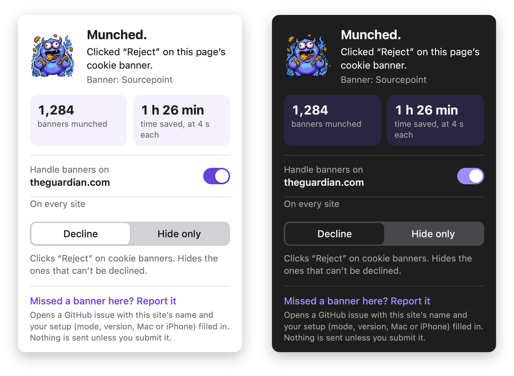

<p align="center">
  
</p>

<h1 align="center">Cookie Munch</h1>

<p align="center">A Safari extension for Mac and iPhone that says no to cookie banners for you.<br>It never clicks Accept.</p>

<p align="center">
  
</p>

> **Developer preview.** Cookie Munch isn't on the App Store yet. On a Mac you can
> [try it in Safari in two minutes](#try-it-on-a-mac-no-xcode), or build it with Xcode and a free
> Apple ID for Mac and iPhone. It's free, open source, and sends nothing anywhere.

## What it does

Pick a mode in the toolbar popup.

**Decline** (the default) answers the banner the way you would if you had the patience:

1. On ~30 common consent platforms (OneTrust, Cookiebot, Didomi, Usercentrics, Sourcepoint, Google,
   TrustArc, …) it clicks their own **Reject** button.
2. On other banners it looks for a button like "Reject all", "Necessary cookies only", "拒否する",
   "Rechazar todo" or "Alle ablehnen" (English, Japanese, most European languages, Chinese and
   Korean), but only inside something that looks like a cookie banner.
3. If a banner only offers **Accept** and **Settings**, it opens the settings, switches every
   optional category off, and saves.
4. About four seconds in (a little later on slow pages), it hides whatever couldn't be declined,
   like "OK"-only notices, and unfreezes the page if the banner had locked scrolling.

**Hide only** works like Brave: it never answers banners. It hides them with
[EasyList's Cookie List](https://easylist.to) (about 34,000 rules, bundled) and blocks many banner
scripts before they load.

The popup tells you what happened on the current page, counts the banners it has handled, and lets
you switch it off for one site. A ✓ on the toolbar button means it handled something on that page.
The popup speaks English, Japanese and Spanish.

## What it never does

- It never clicks Accept, and never follows a link to another page.
- It never collects or sends anything. There's no analytics, no account and no server. All rules
  ship inside the extension. See [PRIVACY.md](PRIVACY.md).
- It doesn't answer "pay or accept" walls in Decline mode, because saying no there means paying.
  (Hide-only mode hides them.)
- It doesn't touch Gmail, Google Calendar, Outlook or Teams with its label search, where "Decline"
  can mean a meeting invite.

## Install

### Try it on a Mac (no Xcode)

Needs Safari 26 or later. The extension stays until you quit Safari.

1. Download this repository (**Code → Download ZIP**) and unzip it, or grab
   `cookie-munch-extension.zip` from the latest release.
2. Safari → **Settings → Advanced** → turn on **Show features for web developers**.
3. Safari → **Settings → Developer** → **Add Temporary Extension…** and pick the `extension` folder.
4. Click the Cookie Munch button in the toolbar and allow it on every website.

### Keep it on your Mac (Xcode)

Needs Xcode and an Apple ID (a free one works).

1. Xcode → **Settings → Accounts → +** → sign in with your Apple ID.
2. Copy `signing.example` to `signing.local` and put in your team ID and an app ID of your own
   (the file explains where to find them; git ignores it).
3. Run:

   ```bash
   git clone https://github.com/ish1620/cookie-munch.git
   cd cookie-munch
   tools/build_app.sh
   ```

   That builds **Cookie Munch.app**, puts it in `/Applications` and opens it once.
4. Safari → **Settings → Extensions** → tick **Cookie Munch** and allow it on every website.

### iPhone and iPad

Build it from your Mac with Xcode, as above, then:

1. The first time only: connect the phone with a cable, tap **Trust**, and turn on
   **Settings → Privacy & Security → Developer Mode** (the phone restarts).
2. Run `tools/install_iphone.sh`. After the first time, it also works over Wi-Fi.
3. On the phone: **Settings → General → VPN & Device Management** → your Apple ID → **Trust**.
4. **Settings → Apps → Safari → Extensions → Cookie Munch** → **Allow Extension**, and set
   **All Websites** to **Allow**.

With a free Apple ID, Apple makes the app stop opening after 7 days. Run the script again to renew it.

### App Store

Not yet. Putting it there takes a paid Apple developer account. If you'd use an App Store or
TestFlight version, add a 👍 to the pinned "App Store" issue. That's how I'll decide.

## FAQ

**Does declining actually stop tracking?**
It gives the site the same "no" you would give by clicking Reject. Whether the site respects it is up
to the site. Cookie Munch doesn't block trackers; use a content blocker for that.

**Why does it need access to every website?**
To see and click cookie banners, it has to run on the pages you visit. It reads a page only to find
the banner. The only things it stores are your settings and a count of banners handled.

**A site looks broken.**
Open the popup and switch Cookie Munch off for that site, then reload. Please
[report it](https://github.com/ish1620/cookie-munch/issues/new/choose) too.

**A banner wasn't handled.**
Open the popup on that page and click **Missed a banner here? Report it**. It opens a GitHub issue
with the site's name and your setup (mode, version, Mac or iPhone) filled in. Nothing is sent unless
you submit it.

**Chrome or Firefox?**
Not yet. Cookie Munch is a standard web extension, so a port is possible.

## Similar projects

Cookie Munch is one of several tools for this. They're all worth a look:

- [Consent-O-Matic](https://github.com/cavi-au/Consent-O-Matic) (Aarhus University): fills in consent
  forms from rules for known platforms. Free on the App Store for Safari.
- [Hush](https://github.com/oblador/hush): a Safari content blocker that hides banners without answering them.
- [BannerBye](https://github.com/BannerBye/BannerBye): rejects banners and sends privacy signals; paid on the Mac App Store.
- Brave, DuckDuckGo and Firefox handle banners inside their own browsers.

Cookie Munch's take: decline first, hide what can't be declined, keep everything on the device, and
let you switch to Brave-style hiding when you'd rather not answer at all.

## Contributing

Missed banners are the most useful thing to report. To add a consent platform or a button label
yourself, see [CONTRIBUTING.md](CONTRIBUTING.md). It also covers testing, debugging and updating the
cookie list.

## Credits

- Hiding rules: [EasyList Cookie List](https://easylist.to) by the EasyList authors. See
  [THIRD_PARTY_NOTICES.md](THIRD_PARTY_NOTICES.md).
- Built with a lot of help from [Claude Code](https://claude.com/claude-code). The mascot artwork
  started in an image generator and was cleaned up by `tools/icons_from_image.py`.

## License

[MIT](LICENSE) for the code. The bundled cookie-list rules keep their own license
([THIRD_PARTY_NOTICES.md](THIRD_PARTY_NOTICES.md)).
